# Android Application Development

Android application development projects completed as part of the Mobile Application Programming coursework, using **Kotlin** and **Jetpack Compose**.

## Technologies

- Kotlin
- Jetpack Compose
- Android Studio
- Room Database
- Supabase / REST API
- Google Maps / Location Services
- Camera Integration

## Projects

### Week 07 – Notes App

A note-taking application that allows users to create and manage personal notes.

**Key Features:**
- Create and save notes.
- Display saved notes.
- Store notes locally using Room Database.

**Screenshots:**

| Default Note | Add Note |
|:---:|:---:|
| 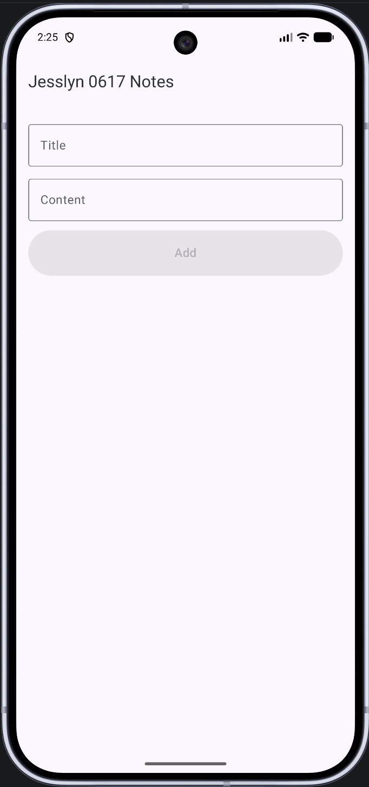 | 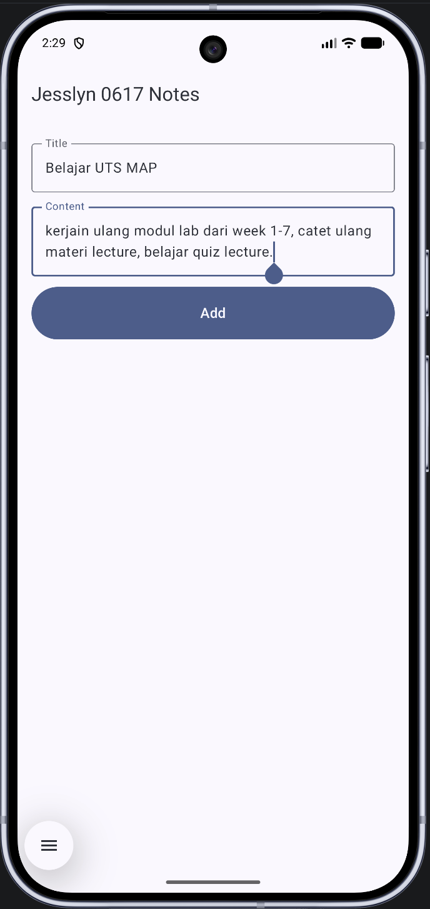 |

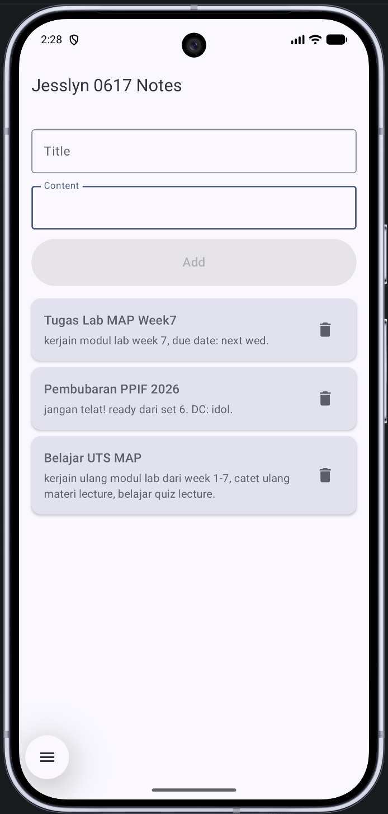

### Week 08 – Product Application

A product application that retrieves and displays product information through an API.

**Key Features:**
- Display a list of products.
- View detailed product information.
- Search and filter products.

**Screenshots:**

| Product List | Product Details |
|:---:|:---:|
| 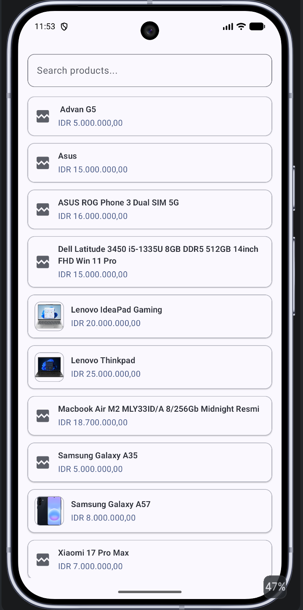 | 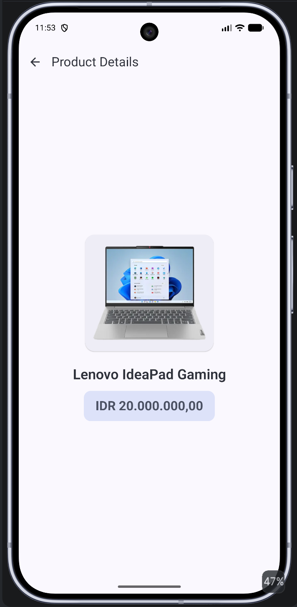 |

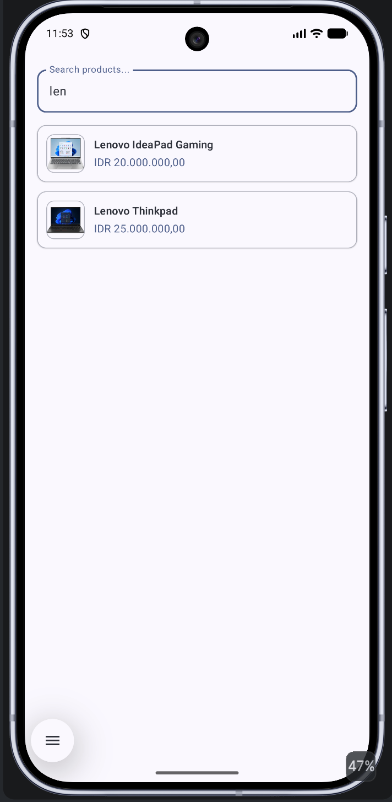

### Week 09 – GPS and Camera Application

An Android application demonstrating GPS location services and camera integration.

**Key Features:**
- Request camera and location permissions.
- Retrieve the device's current location.
- Access the device camera.
- Display the camera preview.

**Screenshots:**

| Options | Location Permission |
|:---:|:---:|
| 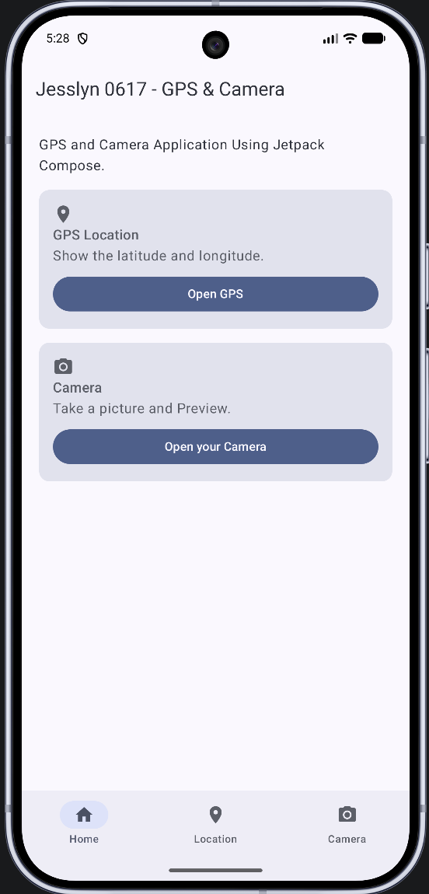 | 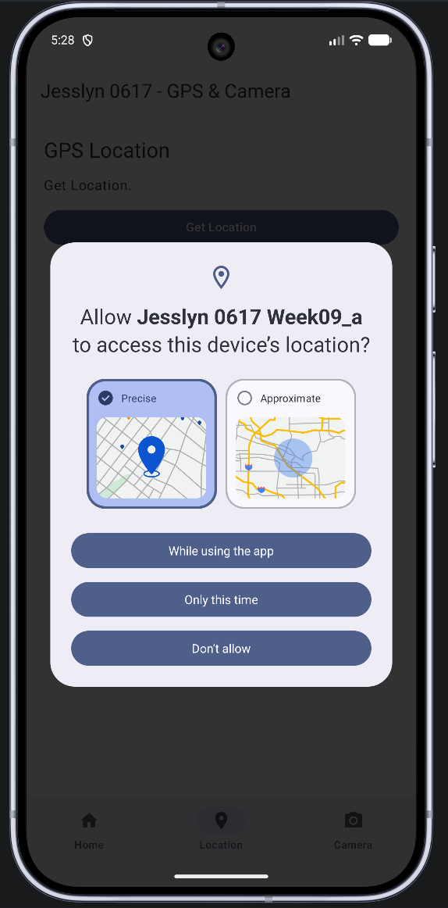 |

| Get Location | Camera Permission |
|:---:|:---:|
| 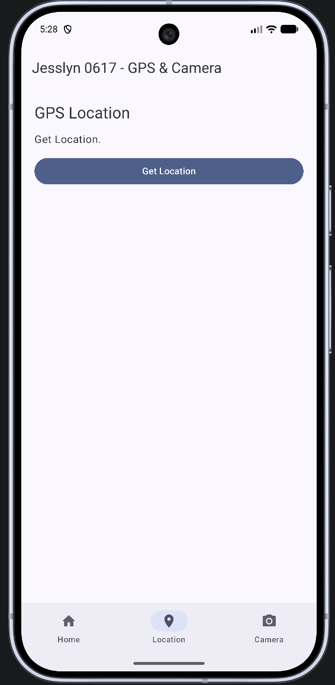 | 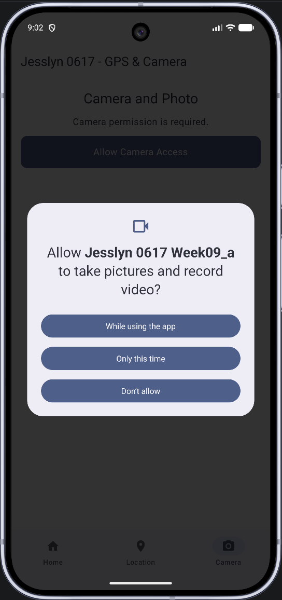 |

| Get Camera | Camera Preview |
|:---:|:---:|
| 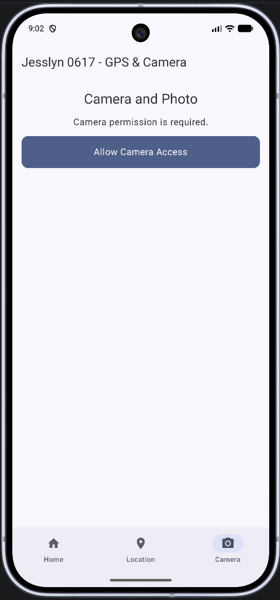 | 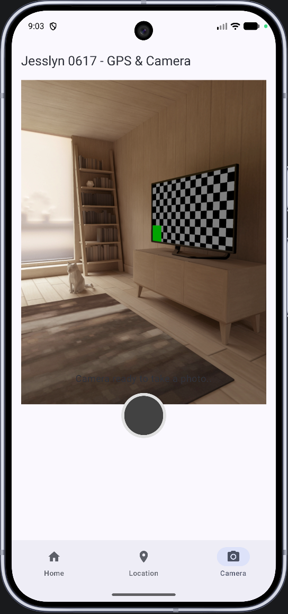 |

## Repository Structure

```text
Android-Application-Development/
│
├── Week-07-Notes-App/
├── Week-08-Product-App/
├── Week-09-GPS-Camera-App/
│
├── screenshots/
│   ├── week-07/
│   │   ├── default-note.png
│   │   ├── add-note.png
│   │   └── notes-list.png
│   │
│   ├── week-08/
│   │   ├── product-list.png
│   │   ├── product-details.png
│   │   └── search-list.png
│   │
│   └── week-09/
│       ├── option.png
│       ├── allow-location.png
│       ├── get-location.png
│       ├── allow-camera.png
│       ├── get-camera.png
│       └── camera-preview.png
│
└── README.md
```

## Getting Started

1. Clone this repository.
2. Open the desired project folder in Android Studio.
3. Allow Gradle to sync.
4. Run the application using an Android emulator or physical device.
